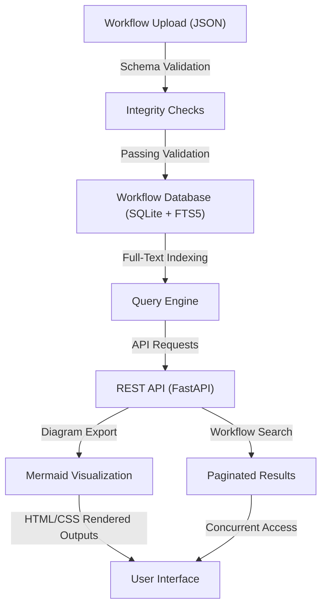

# n8n-Workflow      

## Executive Summary  
**n8n-Workflow** is a scalable, low-memory platform for searching, documenting, and visualizing complex workflows. It powers ultra-fast indexing and retrieval of over 2,000 workflows and 29,000+ nodes using SQLite FTS5, ensuring high availability and seamless integration for workflow teams and development pipelines.

---

## Key Features  
- **Full-Text Search with SQLite FTS5:** Lightning-fast searches through large workflow datasets with precise filtering and keyword matching.  
- **Workflow Validation:** Schema enforcement and automated integrity checks for all contributed workflows to ensure data consistency.  
- **Comprehensive API Documentation:** Clear and developer-friendly API design and usage documentation, including database schema, pagination behavior, and migration paths.  
- **Visual Workflow Generation:** Build and export diagrams on-demand with **Mermaid.js** for intuitive and shareable representations.  
- **Optimized Performance:** Low-memory, read-heavy architecture enabling high concurrency and rapid query execution.  
- **Automated Security Scanning:** Detect and flag credentials and webhook values embedded in workflow contributions to mitigate risks.  
- **Robust Testing:** Extensive test coverage for malformed workflows, Unicode searches, duplicate records, reindexing edge cases, and concurrent access.  
- **Transparent Licensing:** Clear documentation of licensing terms and content provenance for workflows and third-party contributions.  

---

## Architecture & Workflow  

The system operates through modular components to handle workflow ingestion, validation, indexing, querying, and visualization. Below is a high-level diagram that outlines these processes:  



---

## Tech Stack & Tools Breakdown  

- **Languages:** Python for the API/backend logic, JavaScript for UI components.  
- **Database:** SQLite with FTS5 extension for optimized text search.  
- **Framework:** FastAPI or comparable Python API frameworks for building lightweight, high-performance REST APIs.  
- **Visualization:** Mermaid.js for workflow diagram generation and export.  
- **Validation:** JSON schema validation for workflow integrity.  
- **Testing:** Pytest suite for coverage on workflows, API endpoints, and edge cases.  

---

## Quickstart / Installation  

Follow these steps to set up and run the **n8n-Workflow** platform on your local machine:  

### Prerequisites  
- Python >= 3.10  
- SQLite >= 3.35.0 (with FTS5 enabled)  
- Node.js >= 16 (for UI/visualization components)  

### Installation Steps  

1. **Clone the Repository:**  
   ```bash
   git clone https://github.com/EF361/n8n-workflow.git
   cd n8n-workflow
   ```

2. **Set Up a Virtual Environment:**  
   ```bash
   python -m venv env
   source env/bin/activate  # On Windows, use `env\Scripts\activate`
   ```

3. **Install Python Dependencies:**  
   ```bash
   pip install -r requirements.txt
   ```

4. **Run Database Migrations:**  
   ```bash
   python manage.py migrate
   ```

5. **Start the API Server:**  
   ```bash
   uvicorn app.main:app --reload
   ```

6. **Access the Web App:**  
   Navigate to `http://127.0.0.1:8000` on your browser to explore the platform.  

### Running Tests  
To verify the application works as expected:  
```bash
pytest
```

---

## Benchmarks & Metrics (Reproducible)  
Details on indexing speed, query latency, memory consumption, and concurrent testing will be published soon. Benchmarks will be reproducible using a Docker container with controlled workloads.  

---

## Contributing  

We welcome contributions adhering to our **Contributor's Guide**. Please run tests and ensure schema consistency before submitting PRs. Additionally, all workflows must pass our automated credential scanning.  

---

## License  

This project is licensed under the **MIT License**. See the `LICENSE` file for details. Collected workflows and third-party contributions adhere to their respective licensing terms, added transparently to source files.  

---  

*Crafted by EF361: Engineering workflows with precision, transparency, and scalability.*